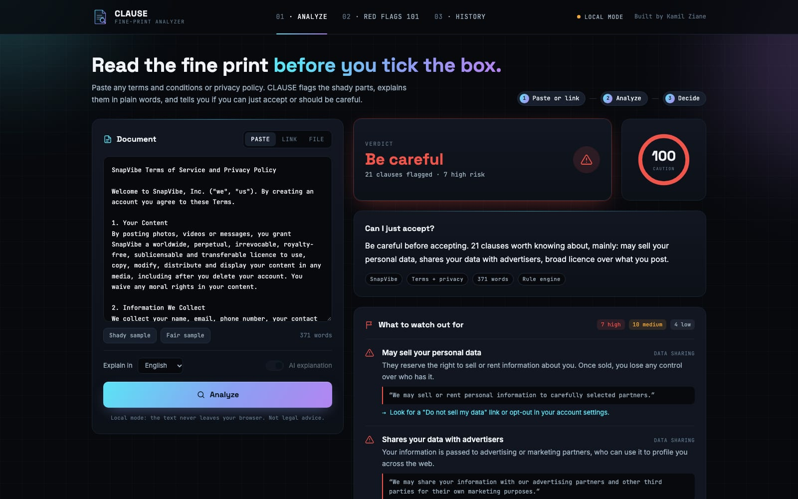

# CLAUSE — Terms & Privacy Policy Analyzer

Paste any terms and conditions or privacy policy, or give the link to one. CLAUSE
flags the shady clauses, explains each one in plain words, and tells you
whether you can just tick "I accept" or should be careful.

**Live demo:** https://clauseziane.netlify.app/ (try it with the shady sample: https://clauseziane.netlify.app/#demo)



## Why I built it

Almost nobody reads the terms before clicking "I accept", and the clauses that
matter are buried among standard legal wording: an auto-renewal that needs a
registered letter to cancel, a licence over your photos that lasts after you
delete your account, a right to sell your data. I wanted a tool that points at
the exact sentence, says why it matters, and is honest when a policy is
actually fine.

## How it works

CLAUSE has two layers.

**1. Local rule engine (`js/rules.js`).** It runs instantly in the browser
and works without the AI. The text is split into sentences and checked against
25 red-flag rules and 8 good-sign rules. Every flag points to the sentence
that triggered it, so the result can always be checked by hand.

| Area | Examples of what it catches | Severity |
| --- | --- | --- |
| Data sharing | selling or renting data, advertising partners, data brokers | high / medium |
| Tracking | tracking across other sites, fingerprinting, targeted ads | medium |
| Sensitive data | biometrics, precise location, health, contacts | high |
| Your content | worldwide + perpetual + irrevocable licences, moral-rights waivers | high / medium |
| Legal rights | binding arbitration, class-action waivers, foreign law | high / low |
| Changes | changing the terms without notice, "continued use = acceptance" | high / low |
| Payments | auto-renewal, no refunds, cancellation by letter or 30 days ahead | high / medium |

A simple negation check stops "we **do not** sell your data" from being
flagged as "sells your data" (it counts as a good sign instead). Each
rule has a weight; good signs subtract. The total is clamped to 0–100:
**≥ 55 Be careful**, **≥ 25 Read before accepting**, otherwise **Fine to accept**.

**2. AI explanation (`netlify/functions/analyze.js`).** With AI on, the text
goes to Google Gemini (free tier) through a Netlify Function, so the API key
never reaches the browser. The model returns structured JSON (verdict, score,
flags with word-for-word quotes, good points, a checklist) that is checked
against a schema. Quotes are matched back into the document to highlight
them. The AI can explain in English, French, Spanish or Arabic, and you can ask
follow-up questions ("How do I cancel?"). If the AI is down or rate-limited,
the app falls back to the rule engine, and you can always switch between the
"AI" and "Rules" views to compare them.

**Reading from a link (`netlify/functions/fetch-policy.js`).** It fetches the
page on the server and strips it down to readable text. Only public
addresses are allowed: hosts that resolve to private or local networks are
refused, and redirects are checked again at every hop.

## Limitations

- **Not legal advice.** CLAUSE helps you notice things; it can't tell you how a
  court would read a clause.
- **The rules are English-only** and keyword-based, so unusual wording slips
  through. The AI layer covers more, but it can also be wrong.
- **Rule scores grow with length.** Tested on 18 real policies, the rule score
  correlated 0.75 with document length, because every rule that fires adds
  points. Normalising for length is the next fix.
- **Keywords miss context.** Context checks now skip sentences where *you* are
  the one acting ("you can change your settings at any time"), sentences about
  protecting you ("defends against fingerprinting"), and promises of notice.
  Other wording will still fool them.
- **AI verdicts can drift near a threshold.** Run three times, two real terms of
  service scored 45/48/68 and 45/65/65, crossing from "Read before accepting" to
  "Be careful". The rule engine is deterministic.
- **Free-tier AI goes down.** During testing Gemini was unavailable for about 2.5
  hours; the app kept working on the rules alone. One fallback model had been
  retired for new keys, so the fallback now retries the main model first.
- **AI quotes are checked, not trusted.** If a quote can't be found in the
  text, it isn't highlighted. On 18 real policies, 154 of 159 AI quotes were
  real (97%); the 5 invented ones were never shown.
- **Long documents:** the AI reads the first 60,000 characters (Netlify
  functions stop after 10 seconds).
- **Link reading** fails on pages that build their text with JavaScript and on
  PDFs; copy-pasting works for those. The private-address check resolves DNS
  before fetching, so DNS rebinding is not fully ruled out.
- **Privacy:** with AI on, the text is sent to Google. Gemini's free tier may
  use submitted content to improve its models, so the toggle exists for a reason.
  With AI off, nothing leaves the browser.

## What I'd do next

1. Build a labelled set of real policies to measure false positives and tune
   the weights.
2. French phrase lists for the rule engine (most of the terms I sign are French).
3. PDF support and a browser extension that checks the terms link on a sign-up
   page.
4. Compare two versions of a policy and explain what changed.

## Run it

The interface is static: open `index.html`, or serve the folder. In local mode
(no backend), only the rule engine runs.

For the AI and link reading, deploy to Netlify with the CLI and set
`GEMINI_API_KEY` (free key from aistudio.google.com) as an environment variable:

```bash
npx netlify-cli deploy --prod --dir . --functions netlify/functions
```

## Structure

```
js/rules.js                       rule engine: sentences, rules, scoring
js/app.js                         rendering and interaction
js/samples.js                     two fictional sample policies
netlify/functions/analyze.js      Gemini analysis + follow-up questions
netlify/functions/fetch-policy.js reads a policy from a link
css/style.css                     theme
```

History is stored only in your browser (verdicts only, never the documents).

---

Built by [Kamil Ziane](https://kamilziane.netlify.app/).
